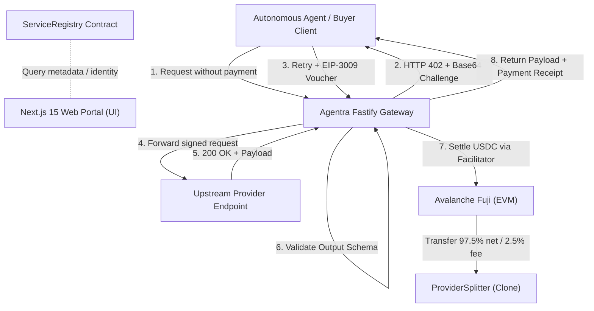

# Agentra

> **The Decentralized Marketplace Where Autonomous Agents Pay Only for Results**  
> *Built on Avalanche (C-Chain / Fuji) · x402 v2 Protocol · ERC-8004 Identity & Reputation*

---

## ⚡ Overview

**Agentra** is a high-performance commerce layer and decentralized service catalog engineered for the autonomous agent economy. Software agents discover specialized tools, pay per request in native USDC on Avalanche, and evaluate providers using cryptographic proof-of-use.

### Core Differentiators

1. **Pay-on-Success Guarantee:** Unlike naive pay-per-call architectures where users lose funds on 5xx errors or upstream timeouts, Agentra gates settlement through a verification proxy. Payment is settled on-chain **only after** the provider returns a valid, schema-compliant 200 OK response.
2. **Proof-of-Use Reputation (Anti-Sybil):** Trust Scores (0–100) are mathematically computed using Bayesian means and Wilson score intervals derived strictly from addresses with confirmed on-chain USDC payment history to the provider.
3. **Zero-Code Monetization:** Developers can wrap any standard HTTPS endpoint into an x402 paywall with immutable revenue splitters without modifying internal business logic.
4. **Agent Spend Guardrails:** Client-side policy engines enforce strict per-call budgets, 24-hour spending caps, category allowlists, and minimum required trust thresholds.

---

## 🏛 Architecture



---

## 📜 Deployed Contracts (Avalanche Fuji Testnet — 43113)

| Contract | Address | Purpose |
|---|---|---|
| **SplitterFactory** | `0x943Bc63D6c8DC18B1B234A6E8B8aF82cFc52adbf` | Deploys deterministic EIP-1167 clones routing 97.5% to provider and 2.5% to treasury |
| **ServiceRegistry** | `0x9e7DedF695e2e165c74e9f6dA1ffA212eBCf66fd` | Tamper-evident on-chain catalog tied to ERC-8004 agent NFT ownership |
| **TaskEscrow** | `0x751D833aB39A4092fB05fA70968eCbb5674DCd3B` | Asynchronous task escrow with EIP-3009 front-running protection and dispute arbitration |
| **USDC (Testnet)** | `0x5425890298aed601595a70AB815c96711a31bc65` | Circle testnet USDC with EIP-3009 authorization support |
| **ERC-8004 Identity** | `0x8004A818BFB912233c491871b3d84c89A494BD9e` | Canonical ERC-8004 agent identity registry on Fuji |
| **ERC-8004 Reputation**| `0x8004B663056A597Dffe9eCcC1965A193B7388713` | Canonical ERC-8004 reputation event oracle |

---

## 🗂 Repository Structure

```
agentra/
├── apps/
│   ├── api/               # Fastify 5 REST API, x402 Gateway, SSE Feed, MCP Server
│   │   ├── src/
│   │   │   ├── gateway/   # x402 challenge parsing, EIP-3009 verification, settlement
│   │   │   ├── discovery/ # Hybrid semantic + BM25 ranking engine (TRD-A §8)
│   │   │   ├── reputation/# Mathematical scoring engine (Bayesian Q, Wilson S)
│   │   │   └── routes/    # Services, Provider, Buyer, Feed, and MCP endpoints
│   └── web/               # Next.js 15 App Router web application
│       ├── src/
│       │   ├── app/       # Landing, Explore, Service Detail, Consoles, Live Feed, Demo
│       │   ├── components/# Reusable design system, TrustScore gauge, ServiceCard
│       │   └── lib/       # API client, Web3 configuration (RainbowKit + Wagmi v2)
├── contracts/             # Core Solidity 0.8.24 contracts (Foundry + Remix compatible)
│   ├── ProviderSplitter.sol
│   ├── ServiceRegistry.sol
│   └── TaskEscrow.sol
├── vercel.json            # Vercel deployment specification
└── LICENSE                # MIT License
```

---

## 🚀 Quick Start

### Prerequisites
- Node.js >= 20.x
- npm / pnpm
- MetaMask or Core Wallet connected to Avalanche Fuji

### 1. Clone & Install
```bash
git clone <REPO_URL>
cd agentra
```

### 2. Backend Setup
```bash
cd apps/api
npm install
npm run build
npm start
# API & Gateway will listen on http://127.0.0.1:4000
```

### 3. Frontend Setup
```bash
cd ../web
npm install
npm run dev
# Web application will be live on http://localhost:3000
```

---

## 🧪 Testing the x402 Pay-on-Success Protocol

You can test the live gateway flow directly via cURL:

### Step 1: Trigger 402 Challenge
```bash
curl -i http://127.0.0.1:4000/v1/s/ev-market-data
```
*Returns `HTTP/1.1 402 Payment Required` along with the `PAYMENT-REQUIRED` base64 challenge header containing Fuji USDC payment parameters.*

### Step 2: Retry with Authorization Header
```bash
curl -X POST http://127.0.0.1:4000/v1/s/ev-market-data \
  -H "Content-Type: application/json" \
  -H "X-Agentra-Buyer: 0x71C83602167d60FA98e82aC95796a56B9F29A3f0" \
  -d '{"state": "Karnataka", "months": 6}'
```
*Returns `HTTP/1.1 200 OK`, `PAYMENT-RESPONSE`, `X-Agentra-Receipt`, and the verified telemetry payload.*

---

## 📄 License

This project is licensed under the MIT License - see the [LICENSE](LICENSE) file for details.

